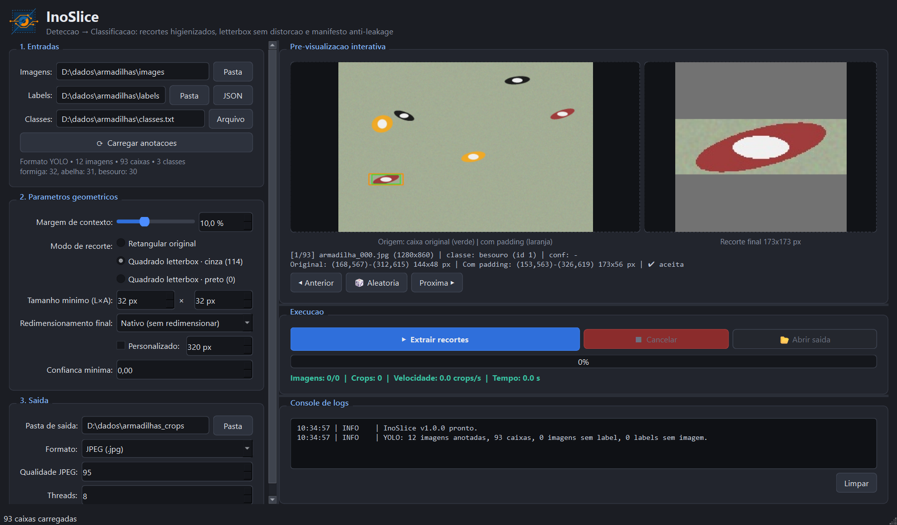

<p align="center"></p>

# InoSlice

**Extração automatizada, higienização geométrica e rastreabilidade de recortes (crops) a partir de anotações ou predições de detecção de objetos — para construir datasets de Classificação de Imagens sem *data leakage*.**

Converte anotações **YOLO (`.txt`)** e **COCO (`.json`)** em uma árvore `ImageFolder` pronta para PyTorch/timm (ResNet, EfficientNet, SwinV2, MaxViT…), acompanhada de um **manifesto CSV** que liga cada recorte à sua imagem de origem e de um **resumo estatístico JSON** da execução.



---

## Sumário
1. [Motivação científica](#1-motivação-científica)
2. [Funcionalidades](#2-funcionalidades)
3. [Instalação](#3-instalação)
4. [Uso — Interface gráfica](#4-uso--interface-gráfica)
5. [Uso — Linha de comando](#5-uso--linha-de-comando)
6. [Saídas geradas](#6-saídas-geradas)
7. [Divisão treino/teste sem leakage](#7-divisão-treinoteste-sem-leakage)
8. [Geometria: padding, clamping e letterbox](#8-geometria-padding-clamping-e-letterbox)
9. [Arquitetura do projeto](#9-arquitetura-do-projeto)
10. [Testes](#10-testes)
11. [Gerando o executável `.exe`](#11-gerando-o-executável-exe)

---

## 1. Motivação científica

### 1.1 *Data leakage* em datasets derivados de detecção
Uma única imagem de campo pode conter dezenas de objetos (insetos numa armadilha, animais numa armadilha fotográfica, frutos numa árvore). Recortes da **mesma** imagem compartilham iluminação, sensor, fundo, compressão e, muitas vezes, o mesmo indivíduo fotografado de ângulos quase idênticos. Se esses recortes forem distribuídos aleatoriamente entre treino e teste, o modelo é avaliado sobre amostras praticamente vistas no treino — a acurácia reportada fica **otimisticamente enviesada** e não generaliza.

O InoSlice registra, para cada recorte, a imagem de origem (`group_id`). Com isso, a divisão pode ser feita com `GroupKFold` / `StratifiedGroupKFold`, garantindo que **todos os recortes de uma mesma imagem fiquem do mesmo lado** da divisão.

### 1.2 Preservação morfológica (*aspect ratio*)
Redes de classificação recebem entradas quadradas (224×224, 384×384…). Redimensionar um recorte retangular diretamente para um quadrado **distorce** a morfologia do objeto (um besouro alongado vira um besouro "gordo"), destruindo exatamente as proporções que muitas vezes discriminam espécies. O modo **letterbox** escala o recorte uniformemente e preenche as bordas com cor sólida — **cinza neutro RGB(114,114,114)**, o mesmo padrão do ecossistema YOLO, ou preto — preservando a forma real do objeto.

### 1.3 Higienização
* **Filtro de resolução mínima**: caixas muito pequenas (padrão < 32×32 px) geram recortes borrados, sem informação discriminativa, que apenas adicionam ruído ao rótulo.
* **Margem de contexto**: um pouco de contexto ao redor do objeto (bordas, apêndices cortados pela caixa justa) frequentemente melhora a classificação.
* **Filtro de confiança**: ao colher a partir de *predições*, descarta detecções de baixa confiança.

---

## 2. Funcionalidades

| Categoria | Recurso |
|---|---|
| **Entradas** | Imagens `.jpg .jpeg .png .bmp .tif .tiff` (busca recursiva, caminhos com acentos no Windows) |
| | YOLO `.txt`: `class x_c y_c w h [conf]` normalizado; linhas de polígono (segmentação) convertidas para a caixa envolvente |
| | Classes via `classes.txt`, `*.names`, `data.yaml` (lista ou dicionário) — detecção automática |
| | COCO `.json`: `images`, `annotations` (`bbox` absoluto, `score` opcional), `categories`; `iscrowd` ignorado |
| **Geometria** | Filtro de tamanho mínimo W×H; margem de contexto 0–30 % (até 100 % via campo numérico) com *clamping* seguro |
| | Modo **Retangular** (proporção exata) ou **Quadrado letterbox** cinza/preto |
| | Redimensionamento final opcional (224, 256, 299, 384, 448, 512 ou personalizado) sem distorção |
| **Saída** | Árvore `dataset_crops/<classe>/<imagem>_crop_<id>.jpg` · `metadata_manifest.csv` · `harvest_summary.json` |
| **Desempenho** | `ThreadPoolExecutor` (OpenCV libera o GIL) + `QThread` para a GUI nunca travar; cancelamento cooperativo |
| **GUI** | PySide6 em modo escuro, preview interativo, progresso em tempo real (crops/s), console de logs, configurações persistidas |

---

## 3. Instalação

Requer **Python 3.10+**.

```bash
python -m venv .venv
```

```bash
# Windows
.venv\Scripts\activate
# Linux/macOS
source .venv/bin/activate
```

```bash
pip install -r requirements.txt
```

---

## 4. Uso — Interface gráfica

```bash
python main.py
```

1. **Entradas** — selecione a pasta de imagens, a pasta de labels YOLO (**Pasta**) ou o arquivo COCO (**JSON**) e, opcionalmente, o arquivo de classes. Clique em **Carregar anotações**: o painel mostra formato, nº de imagens, caixas e distribuição por classe.
2. **Parâmetros** — ajuste a margem de contexto, o modo de recorte, o tamanho mínimo, o redimensionamento final e a confiança mínima.
3. **Pré-visualização** — navegue entre as detecções (◀ / 🎲 / ▶). À esquerda: caixa original (**verde**) e caixa com padding (**laranja**); caixas que seriam descartadas aparecem em **vermelho** com o motivo. À direita: o recorte final **exatamente como será salvo**. O preview atualiza a cada alteração de parâmetro.
4. **Saída** — escolha a pasta de saída, formato (JPEG/PNG), qualidade e nº de threads, e clique em **▶ Extrair recortes**.

Os últimos caminhos e parâmetros são lembrados entre sessões.

---

## 5. Uso — Linha de comando

Quando `--images`, `--labels` e `--output` são informados, a aplicação roda sem GUI (útil em servidores/pipelines):

```bash
python main.py --images dados/images --labels dados/labels --classes dados/data.yaml --output saida --padding 15 --min-width 32 --min-height 32 --mode letterbox --color gray --target-size 224
```

```bash
python main.py --images dados/images --labels dados/annotations.json --output saida_coco --mode rectangular --min-confidence 0.5
```

Use `python main.py --help` para a lista completa de opções.

---

## 6. Saídas geradas

```text
<saida>/
├── dataset_crops/                     # pronto para torchvision.datasets.ImageFolder
│   ├── abelha/
│   │   ├── campo_000_crop_000.jpg
│   │   └── sub__campo_123_crop_002.jpg   # subpastas da origem unidas por "__"
│   └── formiga/ ...
├── metadata_manifest.csv
└── harvest_summary.json
```

O `<id>` do nome do arquivo é o índice da detecção dentro do arquivo de anotação da imagem, tornando o nome **determinístico e reprodutível**.

### `metadata_manifest.csv`

| Coluna | Descrição |
|---|---|
| `crop_filename`, `crop_relative_path` | Nome e caminho relativo (à pasta de saída) do recorte |
| `source_image_filename`, `source_image_width`, `source_image_height` | Imagem de origem e sua resolução real |
| `class_id`, `class_name`, `confidence` | Classe e confiança (vazio para *ground truth*) |
| `orig_xmin … orig_ymax` | Caixa original em pixels (após *clamping*) |
| `padded_xmin … padded_ymax` | Caixa expandida pela margem de contexto |
| `crop_width`, `crop_height` | Dimensões do recorte com padding (antes de letterbox/resize) |
| `padding_pct`, `aspect_mode`, `letterbox_color` | Parâmetros aplicados (`letterbox_color = none` no modo retangular) |
| `group_id`, `source_image_relpath` | **Chave de agrupamento** anti-leakage (caminho relativo da imagem de origem) |
| `detection_index`, `output_width`, `output_height`, `target_size`, `annotation_format` | Rastreio adicional |

Convenção: coordenadas `(xmin, ymin, xmax, ymax)` com `xmax`/`ymax` **exclusivos** (largura = `xmax − xmin`), compatível com o *slicing* NumPy `img[ymin:ymax, xmin:xmax]`. O CSV é gravado em UTF-8 com BOM para abrir corretamente no Excel.

### `harvest_summary.json`
Contém: totais de imagens anotadas/processadas/com falha de leitura, imagens sem label, labels sem imagem, caixas totais, **crops extraídos por classe**, **descartes por tamanho mínimo**, por confiança e por caixa inválida (também por classe), velocidade (crops/s), tempo de execução, mapa de classes, pastas geradas e **todos os parâmetros utilizados**.

---

## 7. Divisão treino/teste sem leakage

```python
import pandas as pd
from sklearn.model_selection import StratifiedGroupKFold

df = pd.read_csv("saida/metadata_manifest.csv")
sgkf = StratifiedGroupKFold(n_splits=5, shuffle=True, random_state=42)

for fold, (train_idx, test_idx) in enumerate(sgkf.split(df, y=df["class_name"], groups=df["group_id"])):
    train, test = df.iloc[train_idx], df.iloc[test_idx]
    # nenhuma imagem de origem aparece nos dois conjuntos
    assert set(train["group_id"]).isdisjoint(test["group_id"])
    train.to_csv(f"saida/fold{fold}_train.csv", index=False)
    test.to_csv(f"saida/fold{fold}_test.csv", index=False)
```

Os caminhos em `crop_relative_path` podem ser usados diretamente por um `Dataset` PyTorch customizado.

---

## 8. Geometria: padding, clamping e letterbox

**Margem de contexto** — para uma caixa de largura $w$ e altura $h$ e margem $p$ (%), a expansão é aplicada **em cada lado**:

$$
x'_{min} = x_{min} - \tfrac{p}{100}w,\quad x'_{max} = x_{max} + \tfrac{p}{100}w,\quad
y'_{min} = y_{min} - \tfrac{p}{100}h,\quad y'_{max} = y_{max} + \tfrac{p}{100}h
$$

Ex.: caixa 100×50 com $p = 10\%$ → 120×60. Em seguida, `floor` nos mínimos e `ceil` nos máximos (nunca corta o objeto) e *clamping* em $0 \le x \le W_{img}$, $0 \le y \le H_{img}$ — caixas junto às bordas são simplesmente truncadas, sem erros de índice.

**Filtro de tamanho mínimo** — aplicado à caixa **original** (antes do padding): descarta se $w < W_{min}$ ou $h < H_{min}$.

**Letterbox** — com $L = \max(W_{crop}, H_{crop})$ (ou $L = $ resolução alvo), o fator de escala $s = L / \max(W_{crop}, H_{crop})$ é **o mesmo nos dois eixos**; o conteúdo $(\mathrm{round}(sW), \mathrm{round}(sH))$ é centralizado em uma tela $L\times L$ preenchida com a cor escolhida. Redução usa `INTER_AREA` (anti-aliasing) e ampliação `INTER_CUBIC`.

**Modo retangular** — mantém a proporção exata; com resolução alvo, o **maior lado** é redimensionado para o alvo.

---

## 9. Arquitetura do projeto

```text
.
├── src/
│   ├── core/
│   │   ├── parsers.py         # YOLO .txt, COCO .json, classes.txt/data.yaml, deteccao de formato
│   │   ├── processor.py       # padding + clamping, filtros, letterbox, resize, preview, E/S de imagens
│   │   └── exporter.py        # CropHarvester: paralelismo, arvore por classe, CSV e JSON
│   ├── gui/
│   │   ├── main_window.py     # Janela principal PySide6 (tema escuro, QThreads, logs)
│   │   └── preview_widget.py  # Visualizador interativo (caixa original vs. padding + recorte final)
│   └── utils/
│       └── logger.py          # Logging com callbacks para a GUI e validacoes de entrada
├── tests/                     # pytest: geometria, letterbox, parsers e exportacao ponta a ponta
├── assets/                    # logo.png (janela/README) e icon.ico (executavel)
├── docs/screenshot.png
├── main.py                    # Ponto de entrada (GUI ou CLI)
├── build_exe.py               # Empacotamento PyInstaller
└── requirements.txt
```

Fluxo de dados:

```text
parsers.load_annotations() ──► AnnotationDataset ──► exporter.CropHarvester.run()
                                                         │  (ThreadPoolExecutor, 1 tarefa por imagem)
                                                         ├─► processor.extract_crops()  filtros → padding → letterbox/resize
                                                         ├─► dataset_crops/<classe>/*.jpg
                                                         └─► metadata_manifest.csv + harvest_summary.json
```

O núcleo (`src/core`) não depende de Qt e pode ser importado em notebooks e scripts.

---

## 10. Testes

```bash
python -m pytest -v
```

Cobrem: padding proporcional por lado, *clamping* nas bordas, arredondamento, filtro de tamanho mínimo e de confiança, geometria do letterbox (com e sem resolução alvo, ampliação e redução), cores de preenchimento, modos de recorte, parsers YOLO/COCO/classes e uma exportação ponta a ponta validando árvore, CSV e JSON.

---

## 11. Gerando o executável `.exe`

Em uma máquina **Windows** (o PyInstaller não faz compilação cruzada), com o ambiente virtual ativo:

```bash
python build_exe.py
```

Resultado: `dist\InoSlice.exe` — arquivo único, sem janela de console (`--onefile --windowed`). Opções:

| Opção | Efeito |
|---|---|
| `--onedir` | Gera uma pasta `dist\InoSlice\` (inicialização mais rápida) |
| `--console` | Mantém o console visível (útil para depuração) |
| `--no-clean` | Reaproveita o cache de build |

Para personalizar o ícone, coloque um arquivo `assets/icon.ico`. Em Linux/macOS o mesmo script gera o binário nativo da plataforma.

---

## Licença
Defina a licença do projeto conforme a política do seu grupo de pesquisa.
